# Rietveld Refinement

example - https://www.researchgate.net/figure/Color-onlinea-Rietveld-refinement-of-the-X-ray-diffraction-pattern-of-CeIr3-The-data_fig1_338547078

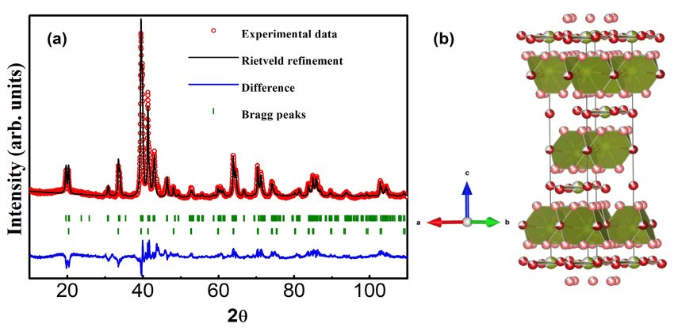

Y = mx + c  
it's very simple to solve

> You have peak width, peak height and peak position.  
> So basically refinement mean that you are going to continuously change the values and  
> ultimately changing the black color graph  
> We need to superimpose onto this experimental graph  

> We have 3 mathematical function  
> Gaussiaon, Laurentizian, Pseudo-Voight functions are used to do the refienement of XRD Pattern  
> In Rietveld refinement, the crystallographic based parameters - u,v,w, background, FWHM.  
> So you essentially have to change the values of those such that calculated plot will have a perfect overlap onto the experimental  
> That is your only objective. Not going to be an easy task.  
> We will practise some examples and it will become clear  

## Rietveld Refinement Steps

1. Step 1 - Convert experimental data into .dat file
   1. Only single row with step size

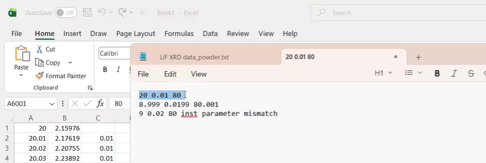

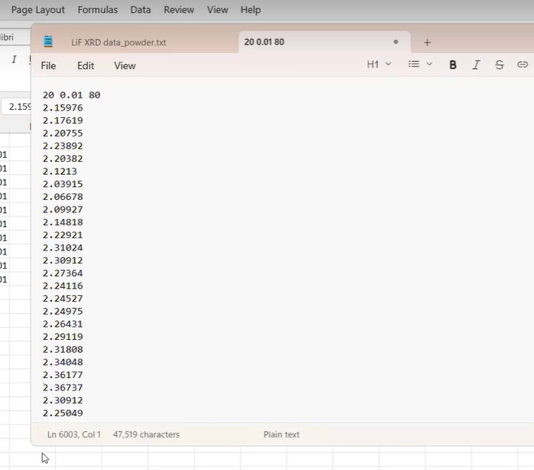

2. Step 2 - Obtain the best available reference file. we have already provided you.
3. Step 3 - Convert .cif file into pcr file  where fullprof will store all the required information and result corresponding to the refinment.

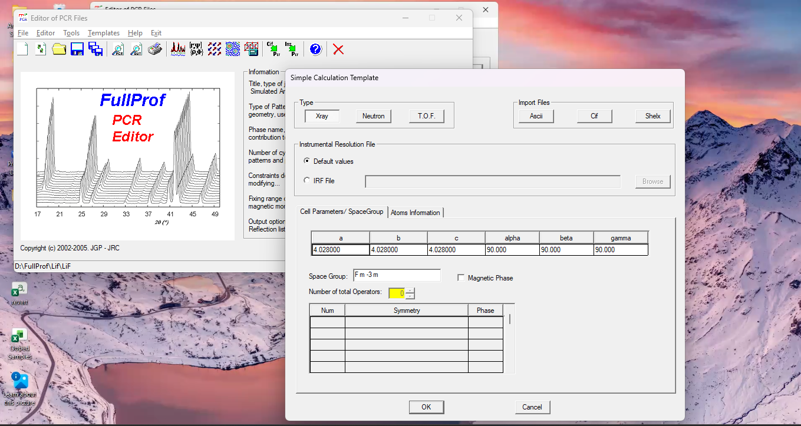

click "ok" and these buttons will be enabled  

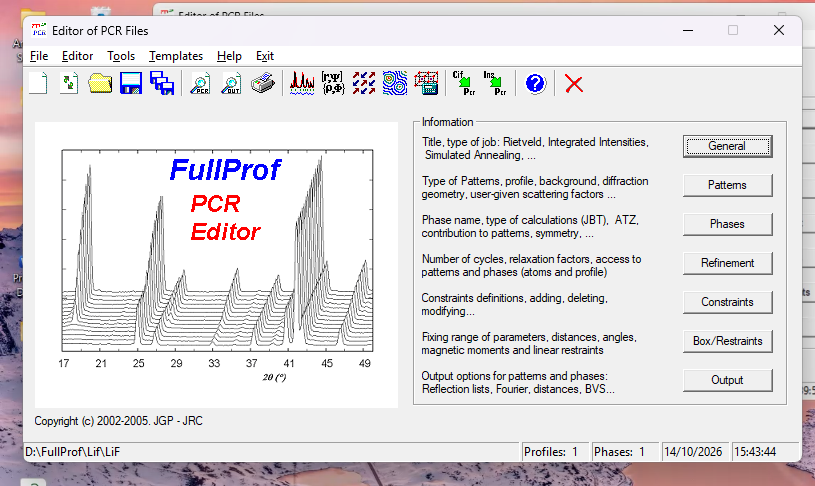

Click on "Save" icon and .pcr file will be generated  

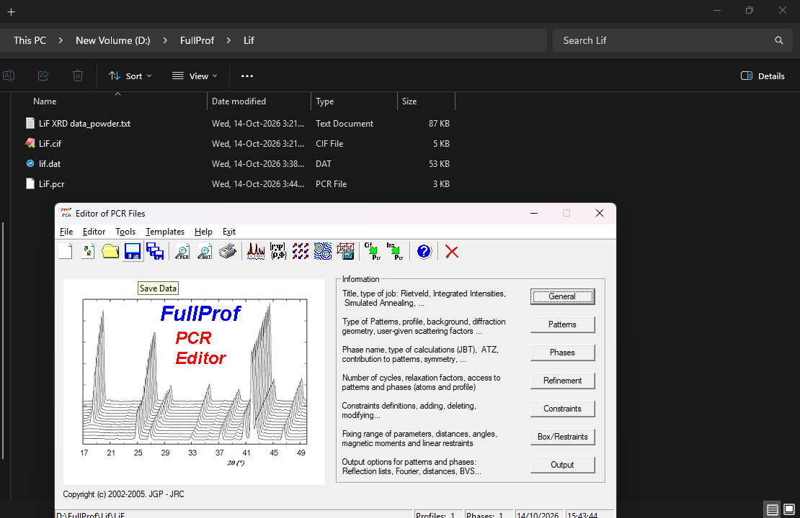

* Give title - Click on general

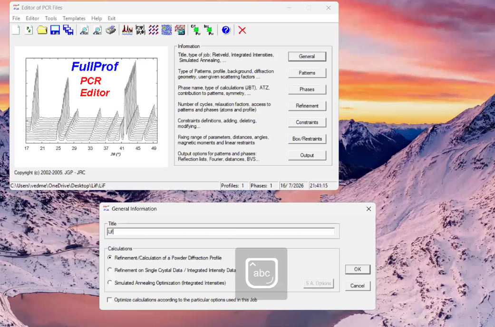

> This is the utmost important file because all the calculation steps, parameter results will be store in this PCR file itself  

* click on Patterns option and and below will open and click on data file peak shape.

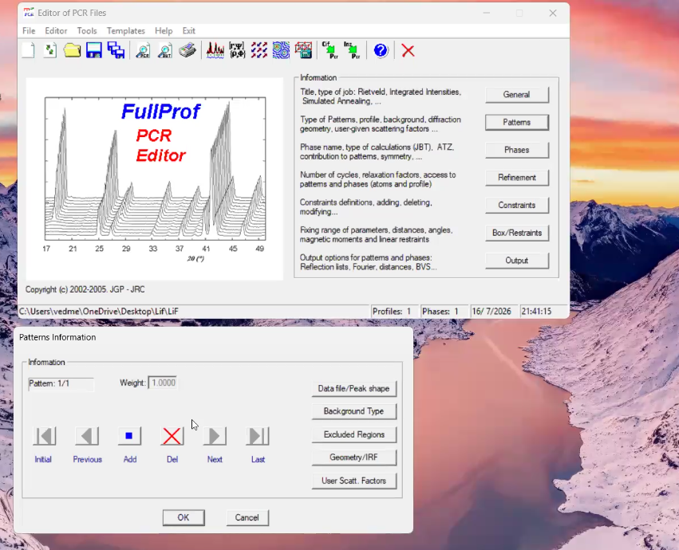

Select File

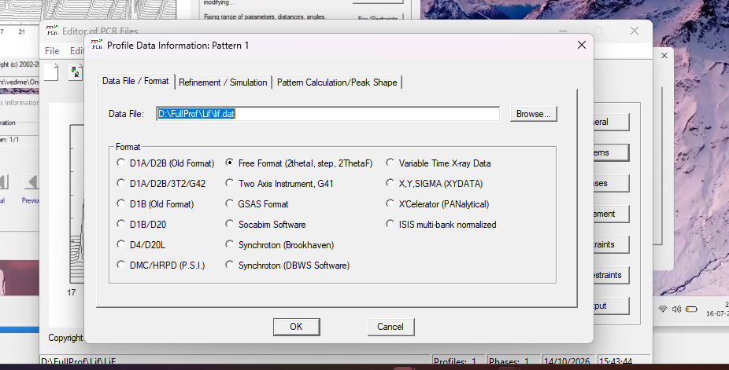    

* Refinement/Solution  

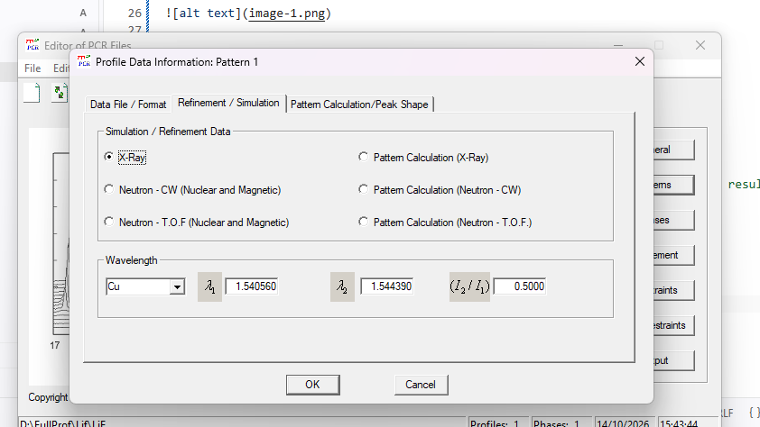

* Select Pseduo-Voight

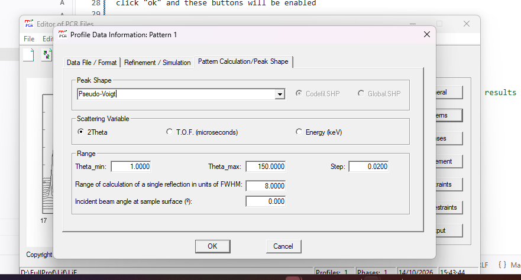

change the theta range 

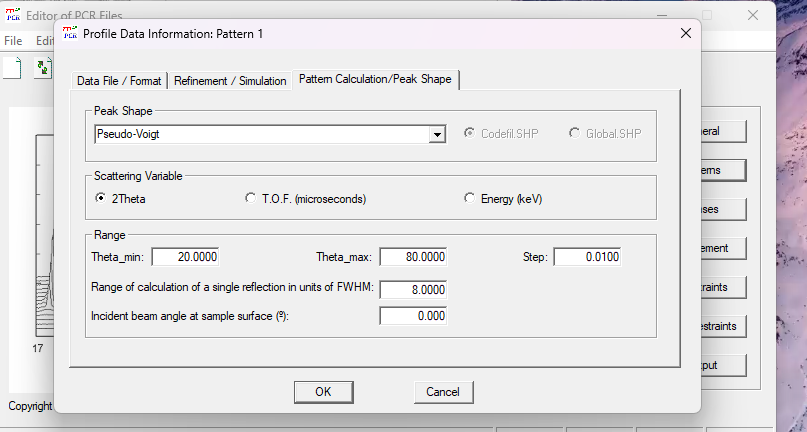

click ok and ok

now change refinement 

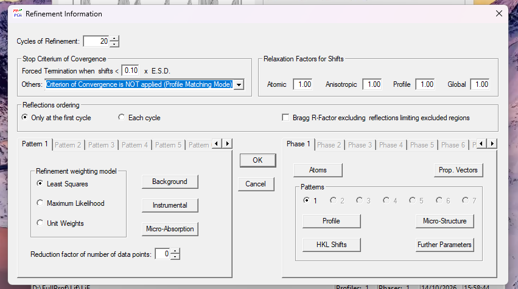

click on save again and that would save whatever changes you would have done.  

Click on Run FullProf Program and you will get graph like this 

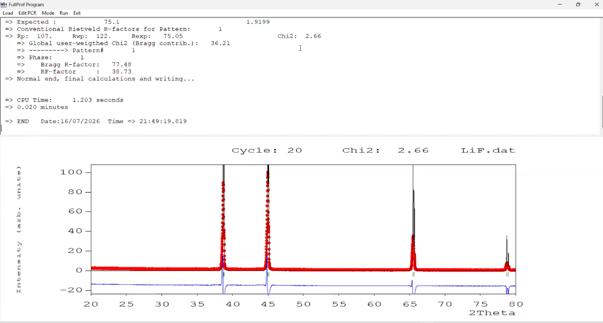

* Red - Black to get the blue
* Our objective should be that Blue line should be straight line after refinement

* Example

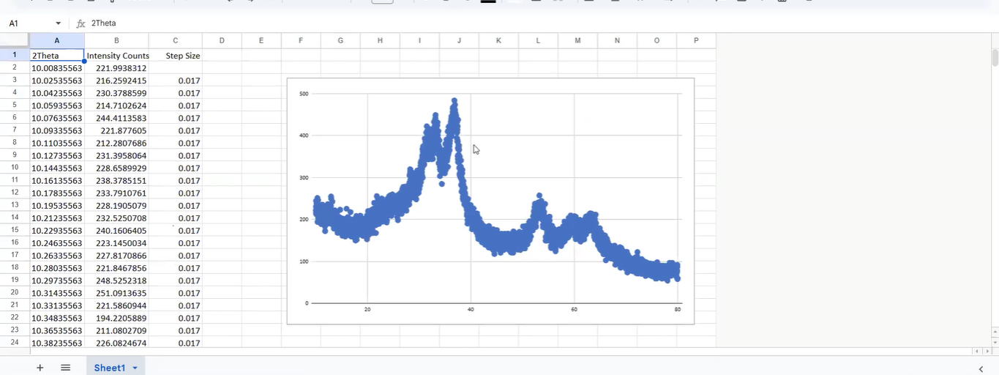

for above peaks are broad. so we need to reduce our step size. you have to do the Background removal or smoothening.