* In this you need not to do background removal as it is already starts from 0.
  * if you still do background removal you will be doing overfitting

 Peak number 1

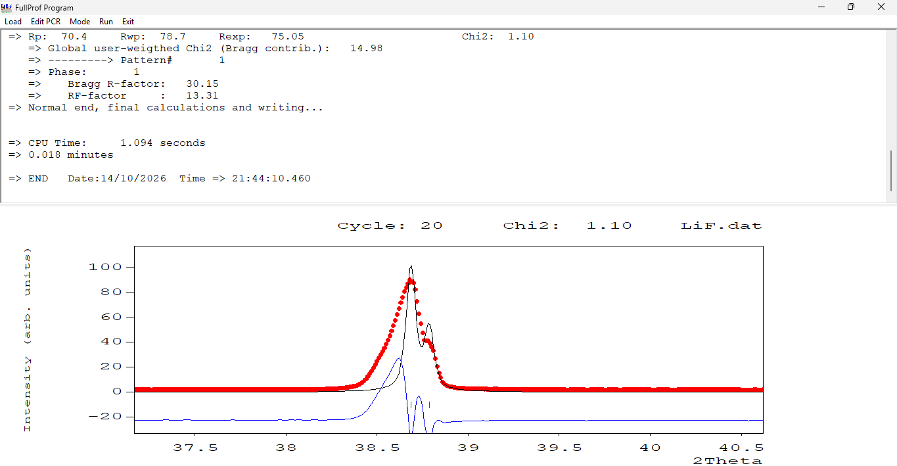

> There is a mismatch between peak width
> Peak width is more in data as compared to calculated one

* Whenever you require the tuning of Theta values, you need to do the tuning of a,b,c parameter
* So whenever the calculated 2theta does not overlap with the experimental one, you are supposed to carry out the a,b,c tuning
* So in above , the 2theta has perfect overlap
* Width is not overlap, intensity is not overlap - I am not concerned about it at this stage.

## Full Width Half Maximum

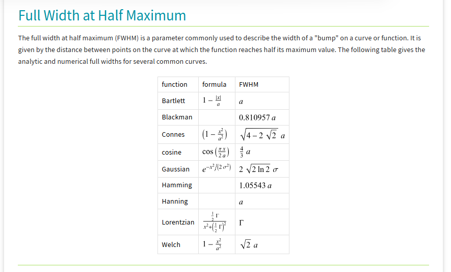

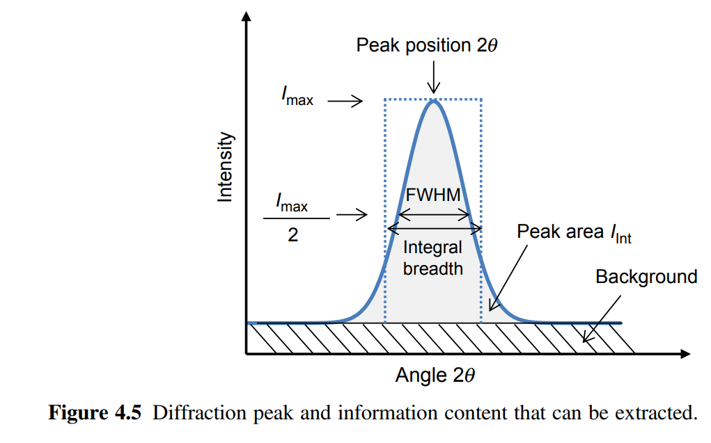

> In above I need to increase the FWHM corresponding to the calculated peak
> FWHM are related to u,v,w parameters. you don't have to go into details of how it is related 

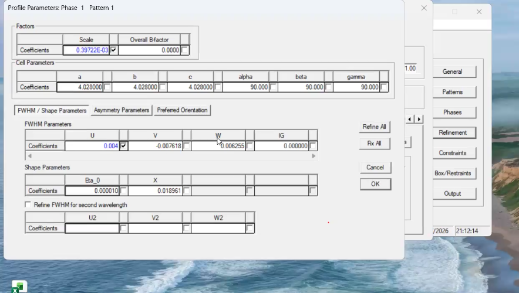

> Do not select u,v, w at a time.
> select u and run and see what happens first

In terms of Intensity we have a better match  

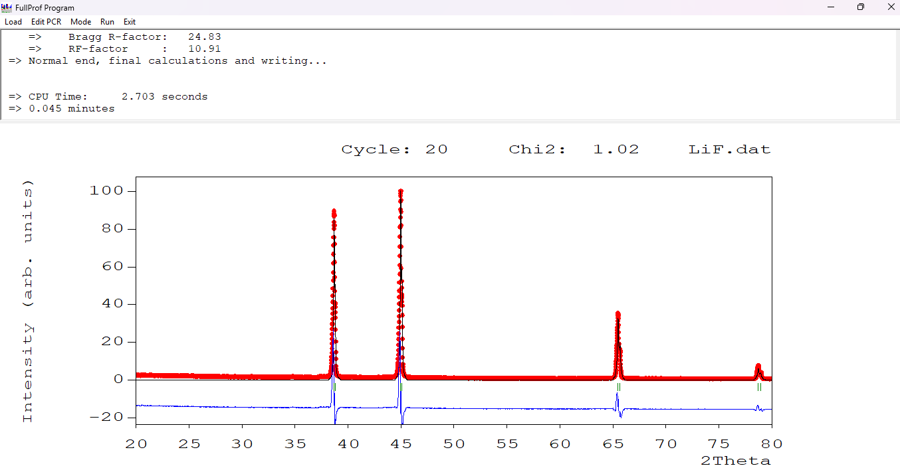

> Rp value should be less than 15%
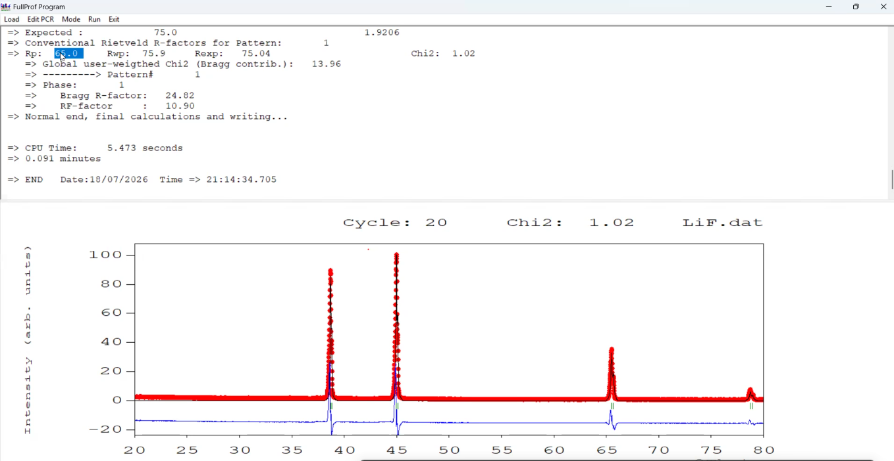

> R is basically corresponds to the residual function
> Rp corresponds to residual function in terms of intensity mismatch
> So in above Rp factor says there is 65% mismatch in terms of intensity , so we need to decrease it  
> Rwp - It defines the total mismatch in terms of experimental and the calculated plot  
> So note that Rp only relates to the intensity part and Rwp it relates to with all kind of mismatches - whether the intensity part, the peak position, width whatsoever.  
> Rwp value you cannot skip and at this stage Rwp value is close to 76%. But where is the mismatch? If I look at the fitting visually, it seems be a very good fit.  

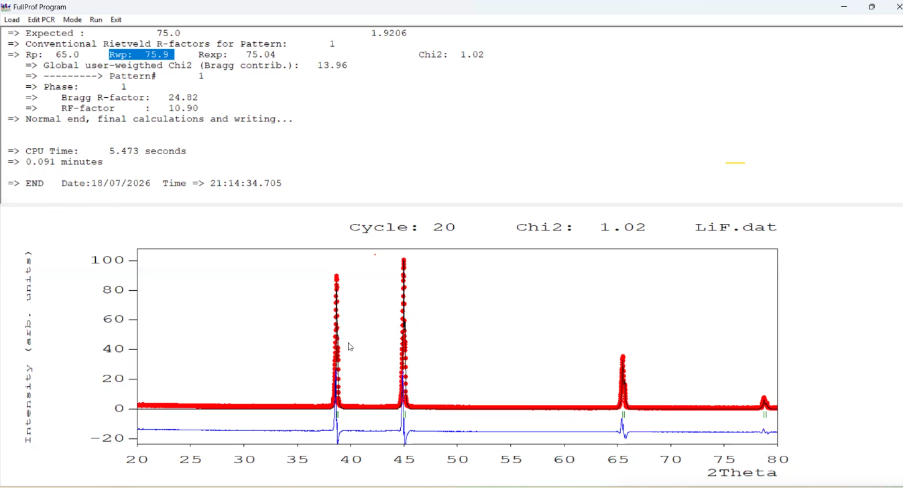

> Now Rexp - The maximum mismatch percentage which you will always have regardless of whatsoever fitting yo do.  
> Or the minimum residual parameter, the minimum mismatch which you will always have regardless of whatsoever refinement you do.  
> Basically Rexp value is a theoritical limit beyound which you cannot reduce the residual value
> Why - tthat depends upon on the quality of the diffraction pattern
> So Rwp should be equal to Rexp.  
> Below Rexp will be over fitting
> Rwp > Rexp may not a good fit  
> Accpetable value of chi2 value is from 0.95 to 2.4  

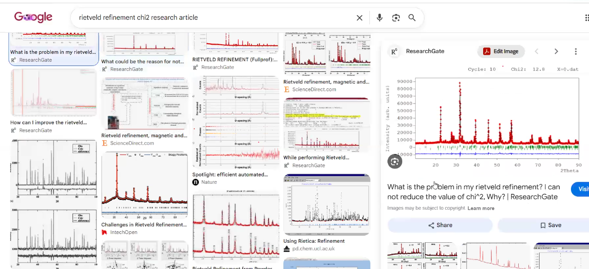

The blue line will have some humps and dumps even on the complete fitting part

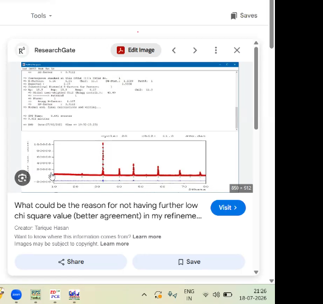

> The intensity count are reaching in the range of almost 1 lakh. So therefore even a slight mismatch in terms of intensity greatly increases the value of chi square.  
> so in these cases wherein the intensity counts increases beyound 10,000 you need to leave the chi square and you need to focus on the residual functions.  
> These residual function should not exceed the value beyound 15%  

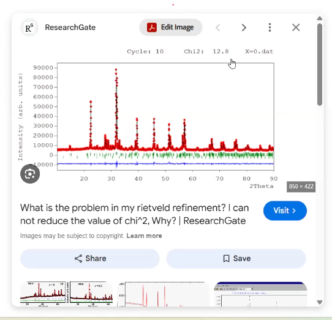

> Typical XRD pattern consists of both sharp peaks at lower 2theta and broad peaks at a higher 2theta  
> So therefor I cannot purely use the Gaussian function and the Larentzian function till the time I sees either all sharp peaks or all broad peaks.  
> So If I get a mix of both, I am going to use another mathematical function which is called as a pseudo voight function  

## Pseudo-Voight function

> It comprises of both Lorentzian as well as Gaussian contribution  
> If Lorentzian component exceeds the Gaussian one, that means peak width will be more or less?
> - It is going to be more  
> Otherwise if the Gaussian component is more as compared to the Lorentzian one then the peaks would be sharp.  

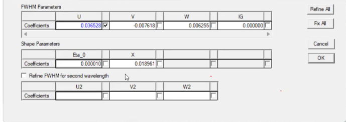

> The software will change the eta X variable for all the peaks and by changing the eta X variable for all the peaks it will have a perfect balance between the Gaussian and the Lorentzian contribution and it will mimic the entire XRD pattern  

Select v and deselct u, run FullProf Program  

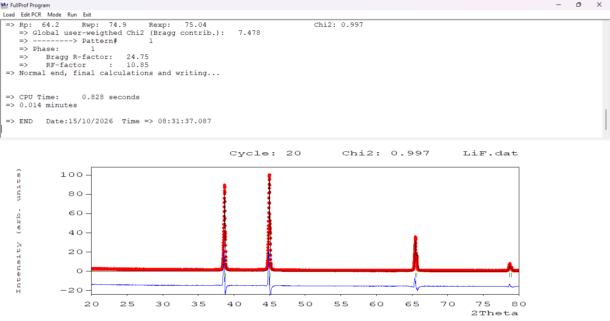

* Rwp < Rexp and so Chi square value is slightly less than 1, which is overfitting but acceptable

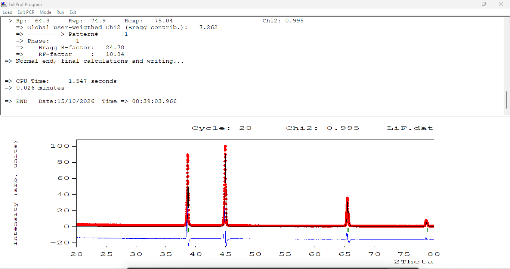

* for above select w and deselect u,v  

* Select Eta parameter and press Ok , again ok and run fullProf program

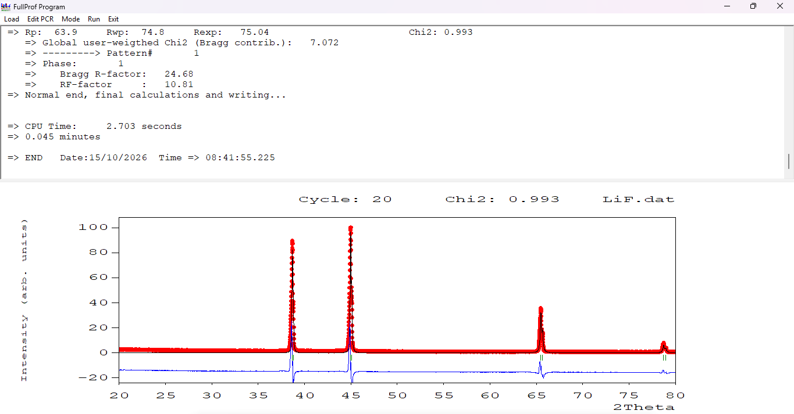

* Select X

> After doing background correction, chi square value is 0.222  

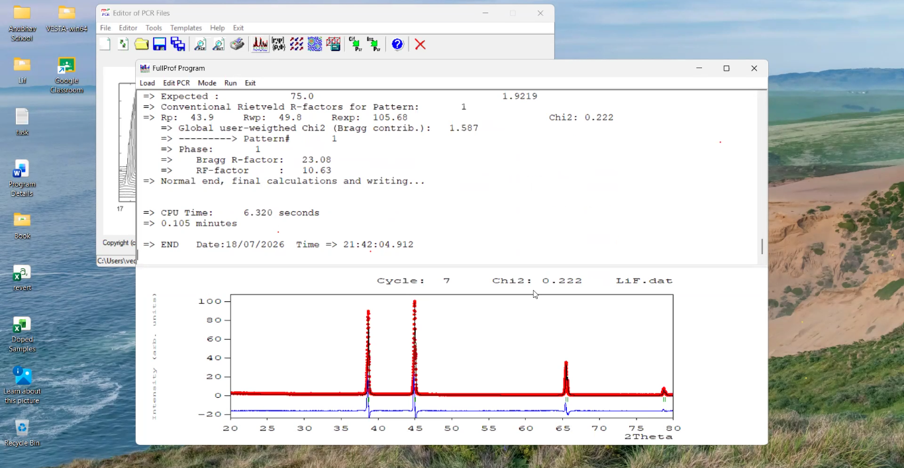

> And that is why you ended up with the overfitting residual function 49.8 which is far lower than the theoritical limit  

> you will get more files after refinement - .out, .prf, .sum, .fst

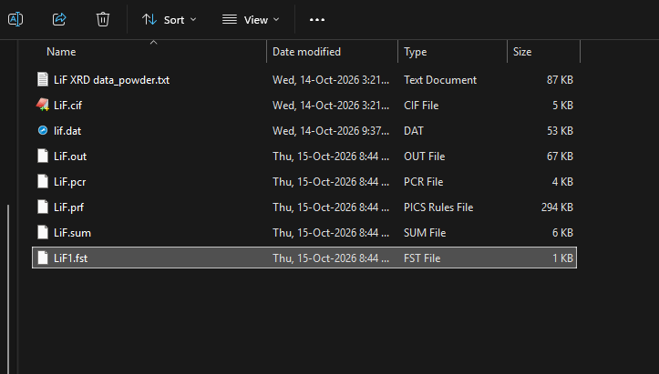

> Deselect all the parameters in the refinement and click on output panel  

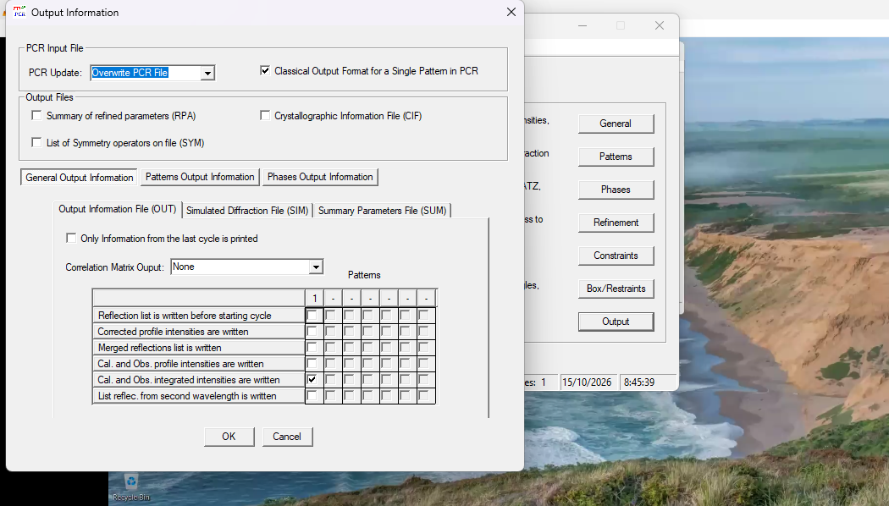

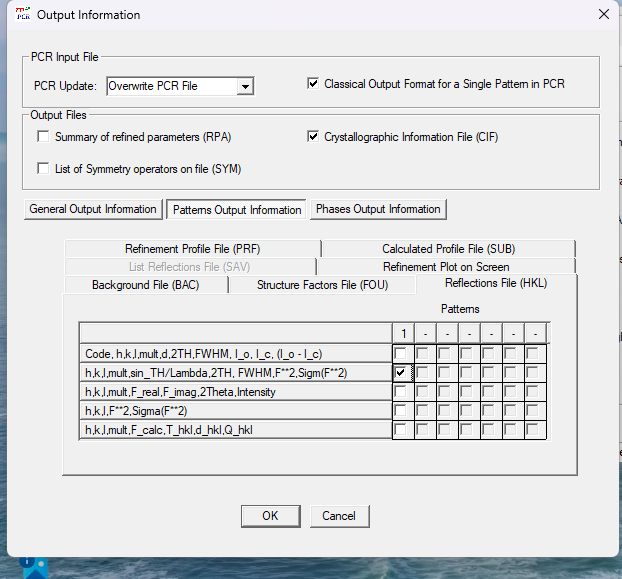

> Now again run the FullProf once again  

you will get 2 more file  

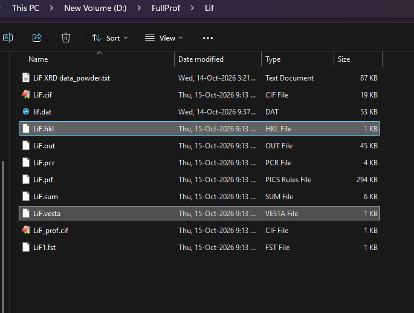

Open the graph using WinPlot

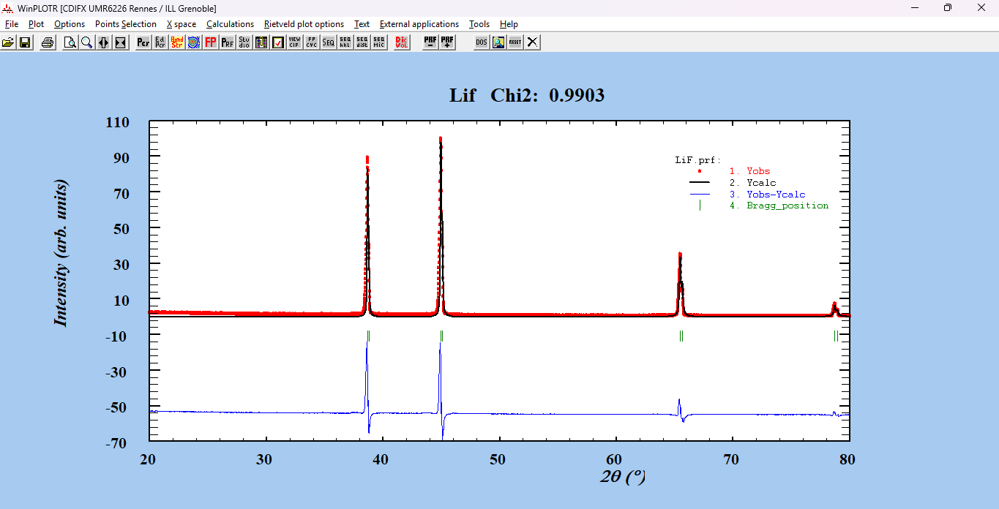

* Import the xyy file in Origin

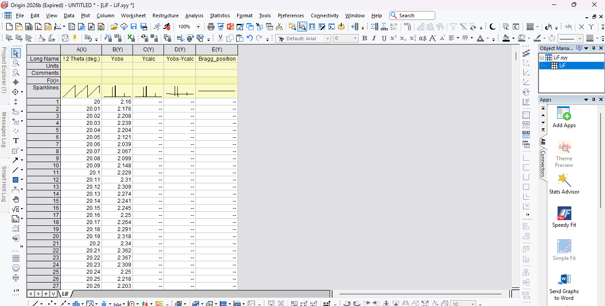