# Analysis of LiF

> As 2theta increases, FWHM value increase. i.e. Peaks become broad

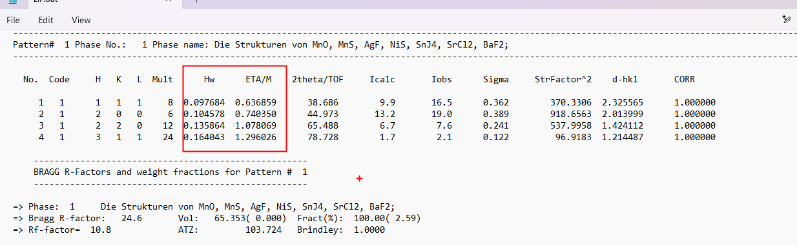

> Now above are two parameters , Hw and ETA. They relates to the Gaussian contribution and the Lorentzian contribution. As in total they corresponds to the shape parameter  
> ETA value increases more dominantly than Hw if we increase from lower theta to higher theta  
> ETA relates to which contribution?  
> Ultimately as you move from lower theta value to high theta value, the peaks ultimately become broader  
> ETA contribution relates to the lorentzian contribution because Lorentz peaks are more sharp as compared to teh Gaussian  

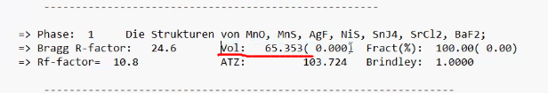

> Above is volume of unit cell. As in multiplied by a,b,c  

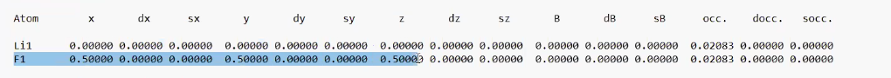

> From above Li occupy the corner and F occupy the body centered.  
> You can alos use AI?  

## BaV3O8

> For newly designed material you have to find .cif file by yourself.  
> We will discuss in tomorrow session  

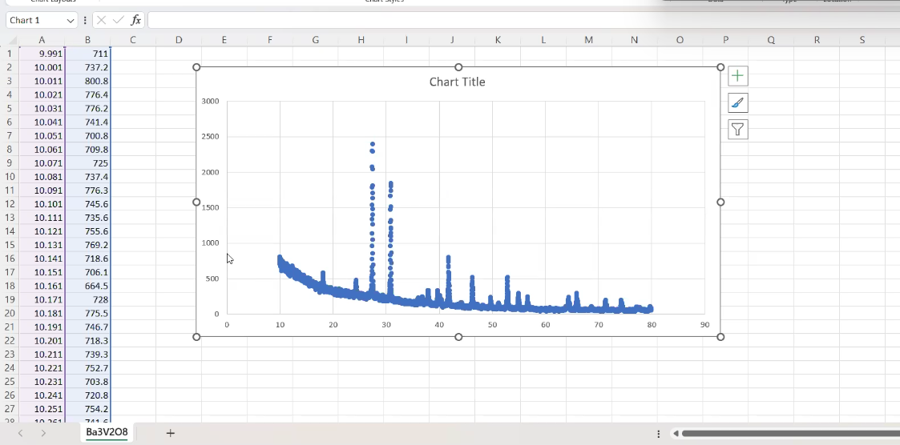

> Look above graph. And tell does it have a background or doesnot have a background?  
> It does have a background. so you see the graph it doesnot perfectly touches  
> to the absolute zero.  
> So therefore we need to do the background correction  
> Also if you see that there are so many small Intensity peaks.  
> So during the refinement we need to take care of them as well  

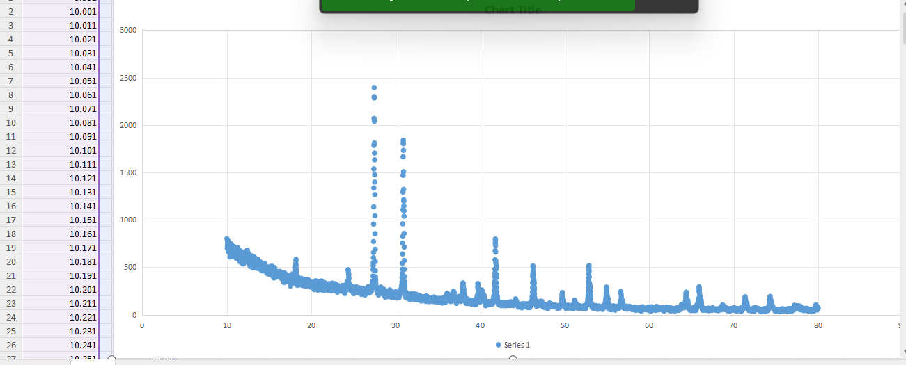

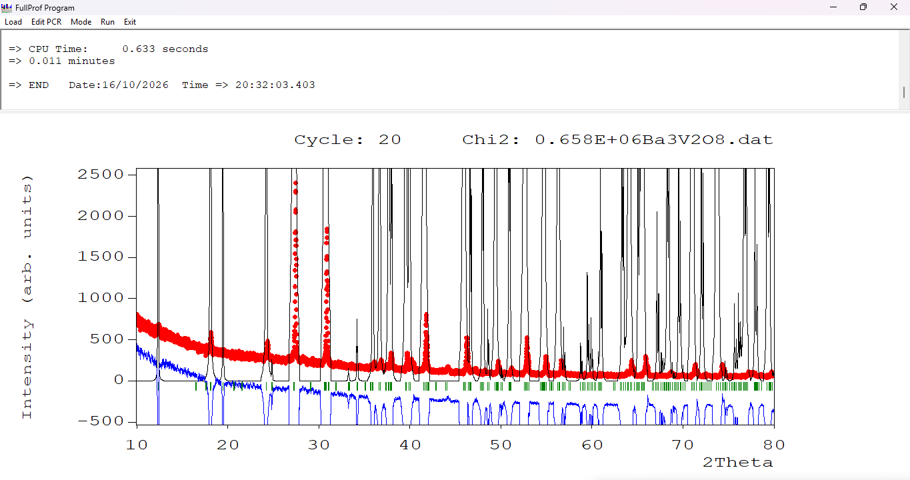

> Look at above graph and tell me where is major mismatch  
> Is the major mismatch lies in terms of intensity part or is it in the background part?  
> Where is the major one as compared to the other one?  
> you see all those peaks, they are going beyound the range of the graph.  
> So it is mainly in the intensity part  
> Background also is there but it is not pronounced compared to the intensity  
> So first I'll first do the intensity correction and then I'll attempt the background correction  
> There is no fixed sequence as in you have to first move with the background and then intensity or first intensity then background  
> You can take any sequence of your choice  
> I usually eliminate that part first wherein there is a major mismatch  

* Scale factor - Select the scale factor

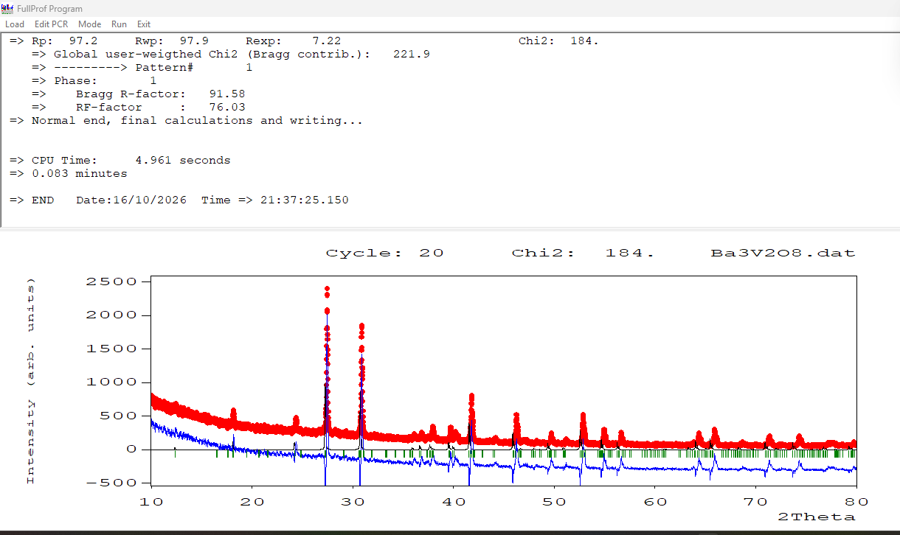

> So I can see now the Chi square is dramatically reduced from 10^6 to 184.  
> But it is still meaningless  
> Now I see that there is a major mismatch in terms of background  
> If I use a straight line to remove the entire background, like if I take a one point here and I draw a straight line, will it eliminate the complete background?  
> or do I need a curved kind of background removal?  
> Definitely I need a curve kind of background removal  
> Because straight line will only work upto over here.  
> from here in this graph background has taken curve shape  
> so therefore a single degree of a polynomial as in Y=mx + c won't work it out  

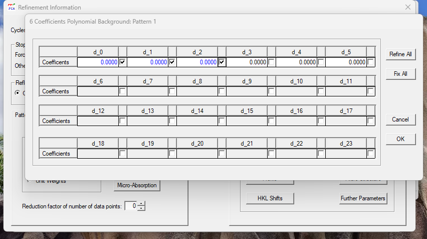

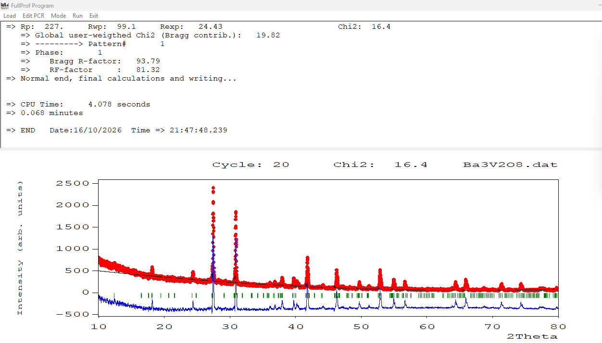

> chi square brought down to 16  
> But i see that still there is some background lying here. So i can take even high degrees of polynomial  

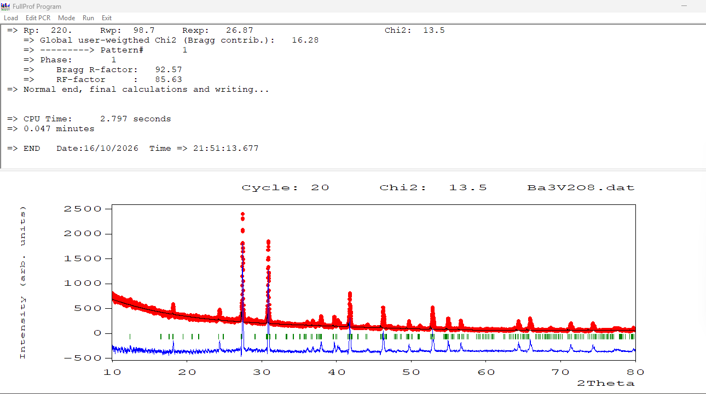

> After adding 6th degree it brought down chi square 13.7 to 13.5  
> Negligible change  
> Am i supposed to take higher degrees of polynomial as compared to this six coeff polynomial?  
> is it required?  
> No because, I am moving from 5th to 6th there was less considerable change of 0.2

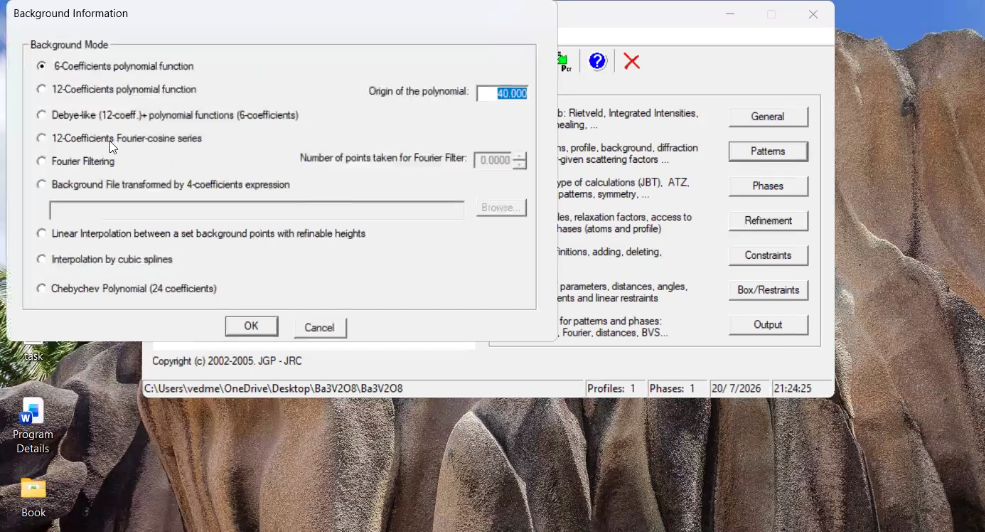

> In case you need higher degrees of polynomial you can go to patterns >> background  and select 12 coeff polynomial function  
> Majoriy of cases 6 coeff will be sufficient  

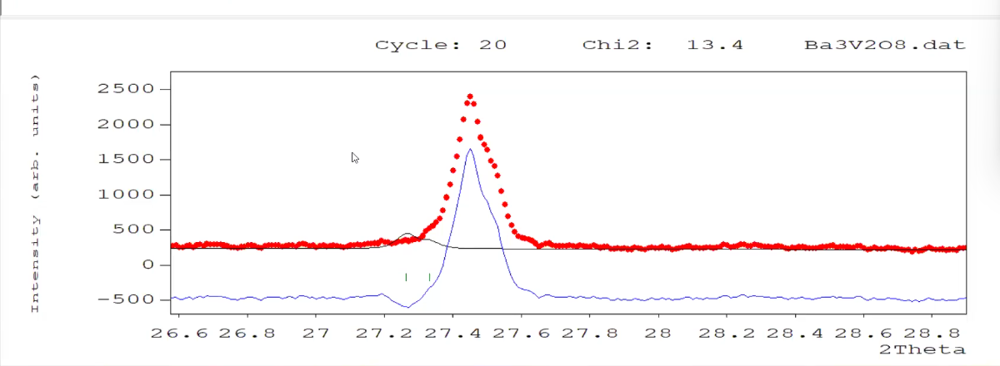

> Think about yesterday session and tell me do I require lattice parameter session  
> Certainly I require , because the experimental 2theta it is lying somewhere around 27.5 and calculated one it is somewhere 27.3  
> So certainly a shift of 0.2 degrees is there  
> So definitely you require a lattice parameter correction as in a,b,c parameter  

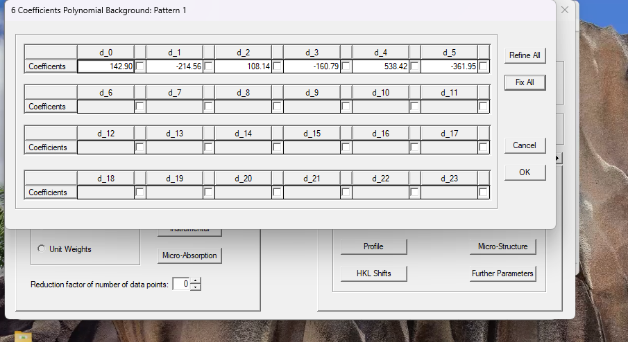

> I don't recommend the option to keep it alwasy active because if you will continously remove the background during the refinement, it may remove those very small intense peaks  
> Which are rather characteristics of your own sample  
> So therefore once you are done with the background removal , you must deselct them and then only you switch to the next parameter  

> First select the a parameter 

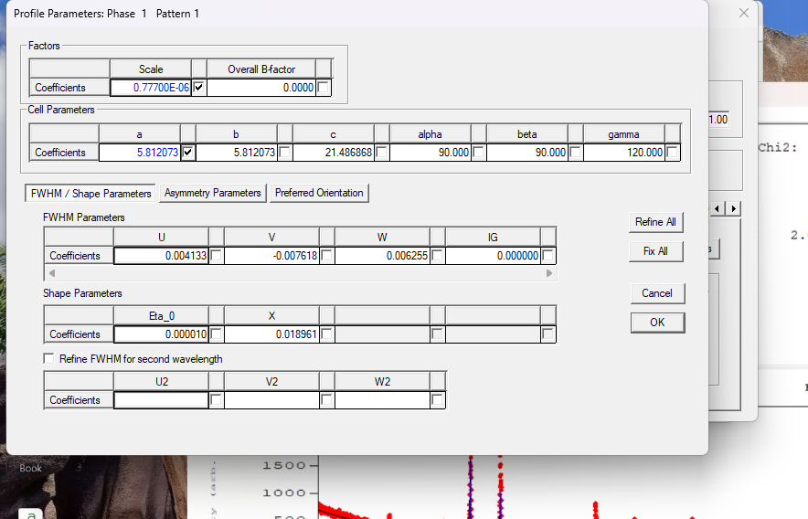

> Reference file which I took for the refinement, it has hexagonal system. A and B are same  
> C is different  
> why I took the hexagonal system, I will discuss it in tomorrow session  

