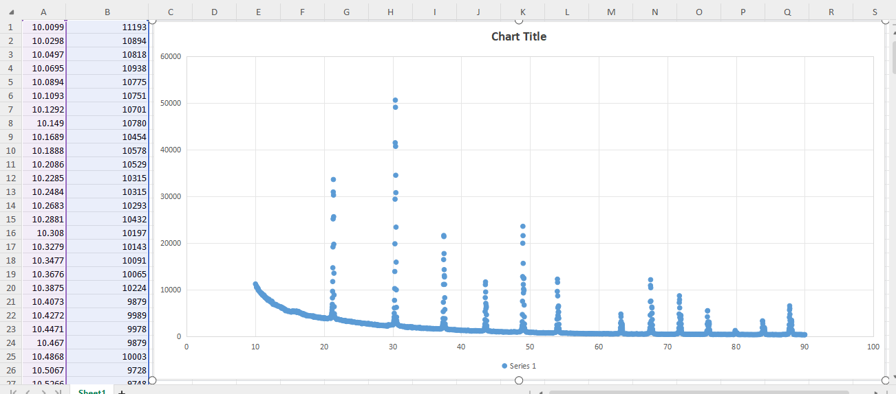
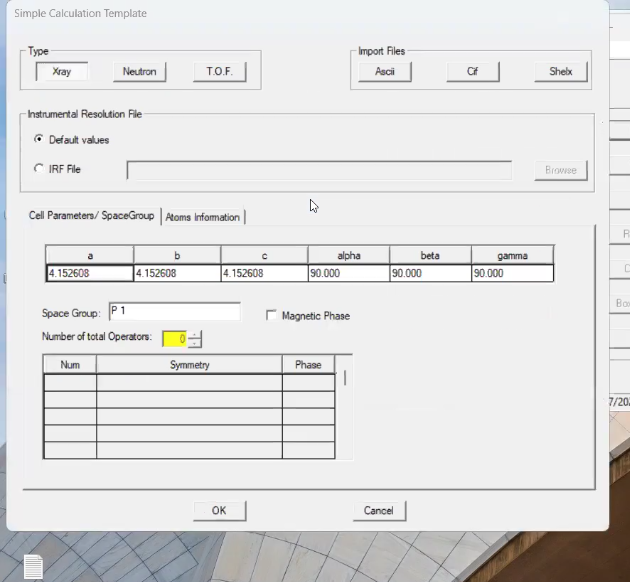
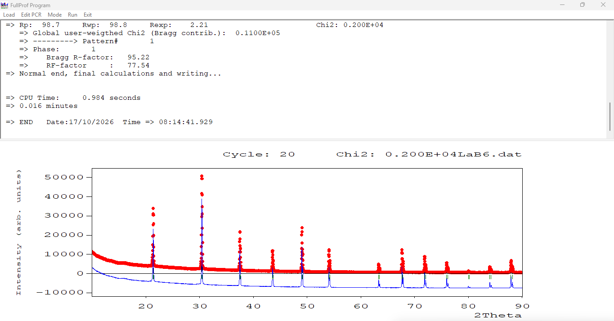
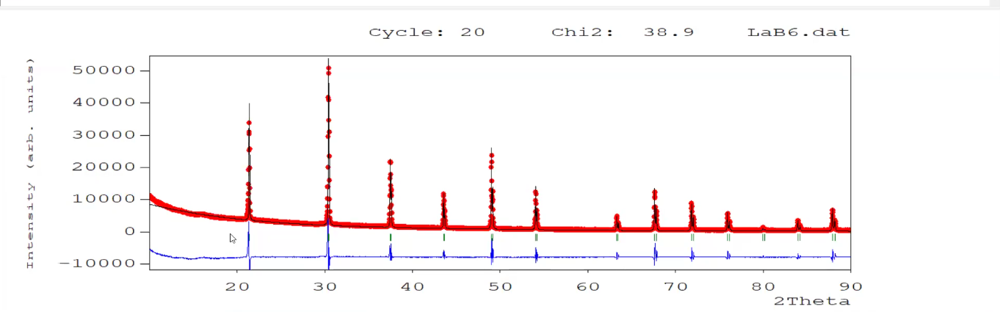
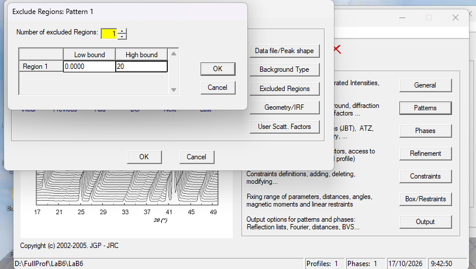
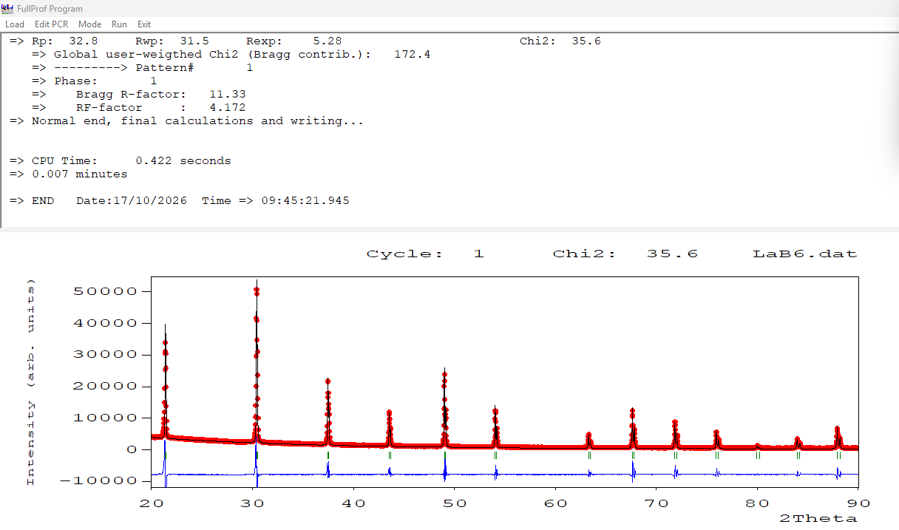

# LaB6

> Look at diffraction pattern  
> we do have a background  
> This sample seems to be more crystalline in nature or less crystalline in nature as compared to Bav2o8  
> We have high intensity so firt  
> So in this case I will mainly work on to the reduction of residual functions as compared to chi square  
> we have two different step sizes  
> I will take 0.0199 as step size  

> If you check above a=b=c and alpha,beta and gamma are equal  
> That reference file has a cubical structure of LaB6  

> above looks like initially  
> So I see that there is a mismatch in terms of intensity as well as the background.  
> And again I see major mismatch lies in terms of intensity  
> So I'll firstly do the intensity correction and then I'll move on to the background  

> Look at the diffraction profile  
> I see there's some background which is yet to be removed  
> I exhausted all the 6 coefficients of polynomial but still this background is left  
> So therefore this needs a removal without adding a more degrees of polynomial  
> Do you see any existing experimental peak within this zone that means below then 20 degree  
> So in these kind of cases wherein you have the residual component, background component which doesnot have experimental peak, we will exclude that zone  
> so any zone, wherein you have a finite background but doesnot have a experimental peak can be excluded from the refinement  

> Click on Excluded region  

> Now work on lattice parameter correction, FWHM correction and then zeor point correction  

> If u comes negative value after refinement, just remove negative sign and then do the re-refinement  
> 