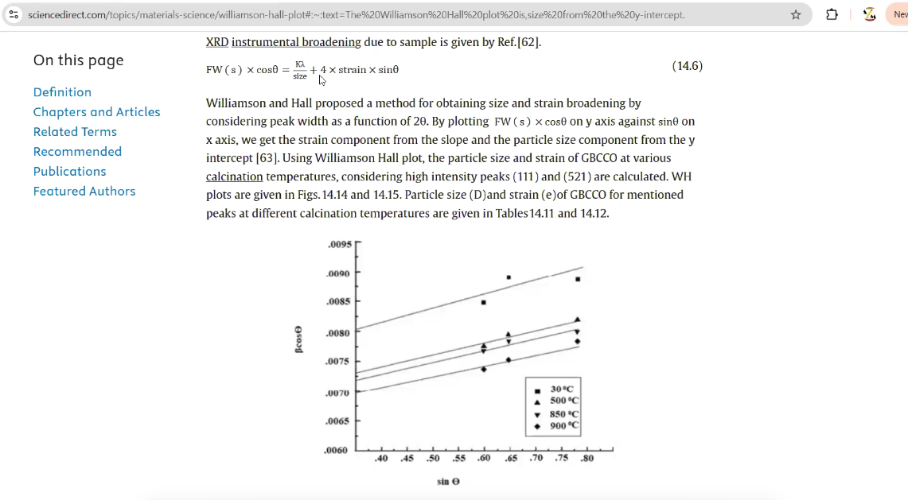
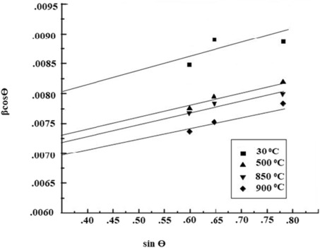
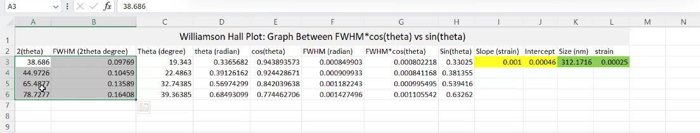
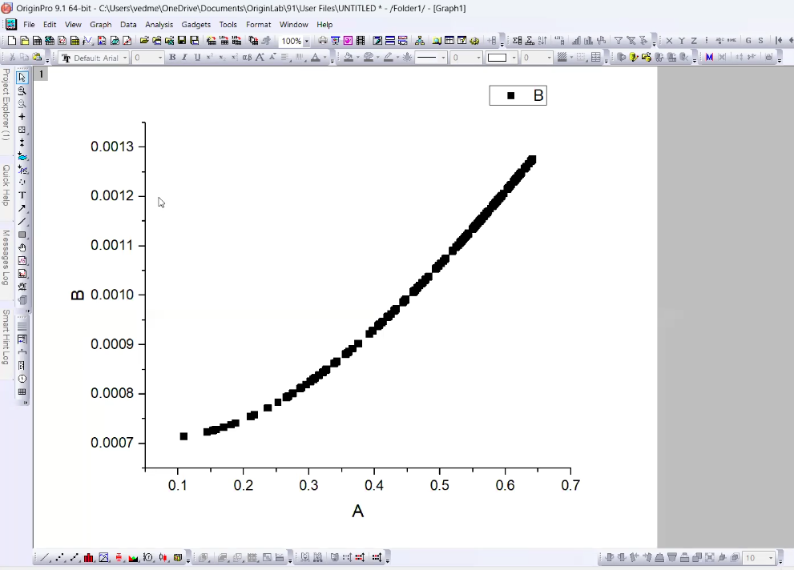
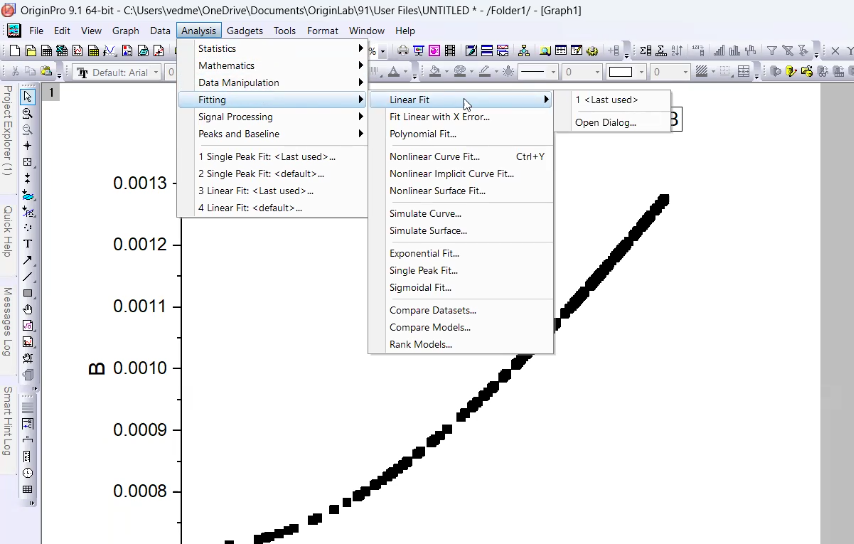
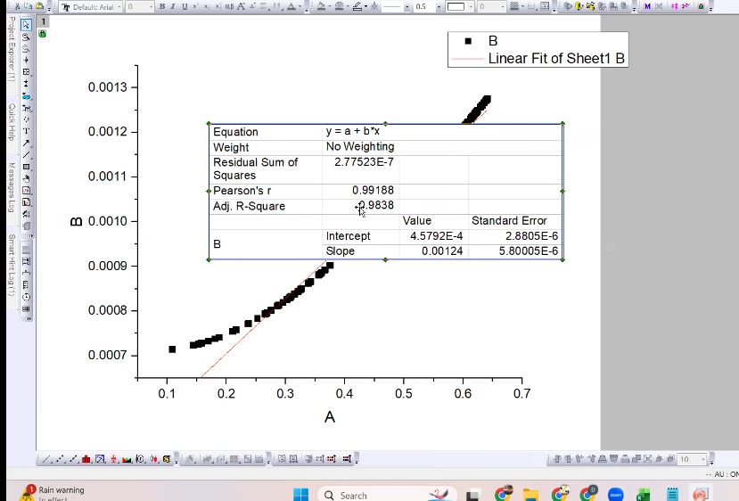
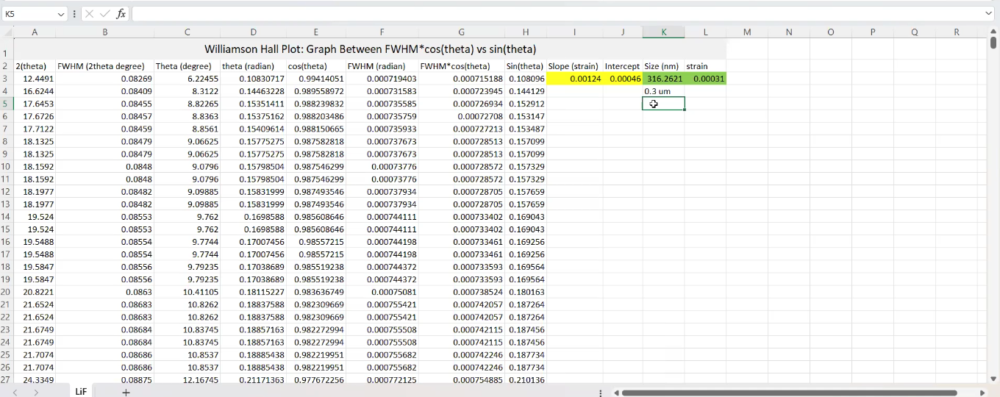

# Williamson Hall Plot

The Williamson Hall plot is defined as a method for obtaining particle size and strain broadening by plotting the peak width as a function of angle (2θ), allowing the determination of strain from the slope and particle size from the y-intercept.

> When I say the size over here, we are estimating the average crystallite size  
> Now what is the average crystallite size? how does it differ from Median crystallite size and how to obtain those medium crystallite sizes, we will discuss in the tomorrow session  
> So right now we are on to the average crystallite size estimation  

> Using above relation you can corealte FWHM of a given experimental peak multiplied by Cos theata  
> K is instrumental parameter which ahs a  constant value of 0.91 up to 1.0  
> The safe value is 0.94  
> Lambda corresponds to the wavelength of the monochromator  
> k aplha = 1.54  

> In above size is average crystallite size  
> Now we have couple of discussion  

> Now when we move from peak number 1 to peak number 2 to peak number 3 in the experimental diffraction pattern, the theta value certainly changes  
> What about FWHM does it change?  
> Yes FWHM also changes. So LHS is a variable quantity  
> K and lambda is constant  
> Crystallite size does not change. It's a physical parameter. It's a characteristic of your sample itself  
> What about Strain? does it changes from peak 1 to 2 ? No  
> So above equation is basically a straight line equation  
> you can see that in below figure  

> will it be possible that straight line will pass through origin?  
> No if that pass, then crystallite size will be infinite  
> is it possible straight line pass through negative y intercept? No  
> is it possible to have zero value of slope  
> Strain is vector or scalar quantity?  
> Strain is force per unit length  
> Negative slope means negative strain i.e. compressive forces within the lattice  
> Positive strain means expansive forces within the lattice  

> If we move from 30 degree to 500 to 850 degree, is there any change in the value of the strain  
> There is no change in value of the slope and are equal  
> And if slopes are equal that means there is no impact on the strain with the change in the temperature.  
> So what basically changes with the temperature?  

> I can see with the change in the temperature, their intercepts are changing and if the intercepts are changing the crystallite size is changing  
> Practically what do we know that with the increase in temperature the crystalline volume is supposed to increase and if the crystallite volume will increase the intercept which is inversely proportional to crystallite size it is supposed to decrease and that is what you are observing here  

> how to obtain FWHM values ?  
> You have the HKL file and .out file  
> From there you will get the value of 2theta and corresponding FWHM values  
> So what do you have to do it?  
> You need to insert those value  

## Reference File

> How to obtain the best available reference file from the database?  
> So before I discuss about what is the best available reference file, we need to understand what is the meaning of reference file  
> So see our reference file is basically a file wherein couple of parameters pertaining to the refinement are written  
> So now you have to corelate whatsoever we have studied in the last 3-4 sessions  
> I discussed that we have to do the rietveld refinement and to do the rietveld refinement we need to provide the experimental data we have already provided in terms of that file on the basis of that software plots  
> The XRD Pattern - the red color plot  
> Black color plot - that is the calculated one  
> We need a mathematical equation to plot it, which mathematical equation we had used to plot it?  
> That was the pseudovoight function  
> And in the pseudo-voight function we need to provide some values such that it will plot a black color calculated graph  
> So from where do you get those values to plot the calculated pattern those values comes from the reference file  
> What is the role of reference CIF file, clear?  

> 