## Particle Size Distribution graph


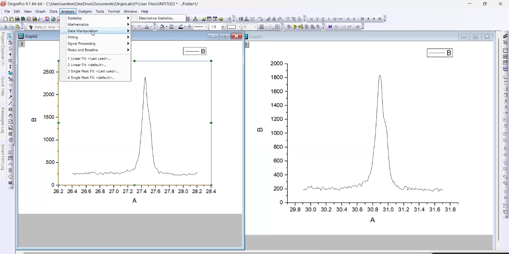

above two peaks I need to fit 

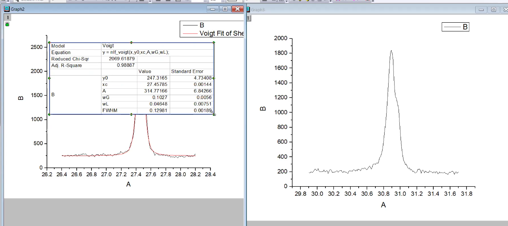

above is using voight function  

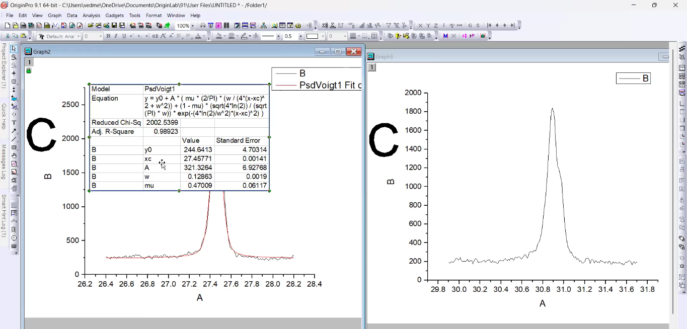

above is using psedo-voight function  

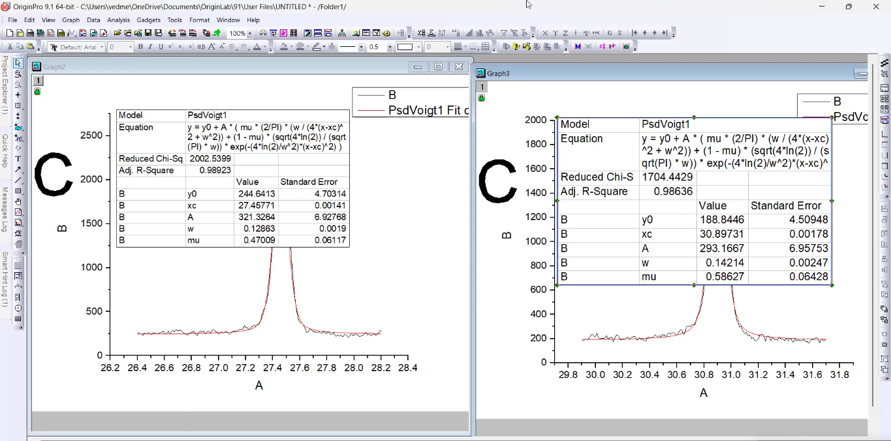

## Breadth

* Install the Breadth software
* open the psd.bri file in notepad
  * It is basically a configuration file
  * The first line corresponds to your sample name. you can define name any name
  * The second line define the wavelength of the monochromator which you would have used at the time of data acquisition
  * So Copper k alpha becomes 1.54 Angstrom.
  * Third line defines what type of mathematical function you had used at the time of Rietveld refinement.
  * e.g. `2 - pseudo-Voight`
  * The next two lines are basically for two most intense peaks in the XRD data
  * And you need to provide their HKL values.
  * e.g. **38.66126 are theta values.**

Question - can we obtain the HKL values after rietveld refinement?  
Yes.

* Next you need to provide FWHM . from above - 0.21496  
* Next you need to provide the value corresponding to the eta function Which we use at the time of refinement. e.g. - 0.53191
* Now we need to provide two more values.
* Error in refining the FWHM and error in refining the eta value  
  * The Rietveld refinement doesnot provide the values in error of refining FWHM and error in refining ETA  
* So we are going to carry out the individual peak fitting in the origin software, otherwise Rietveld refinement would be sufficient enough to carry out the PSD analysis  

* Syntax
```txt
h k l 2theta FWHMvalue errorInFWHM etaValue errorInETAvalue
```
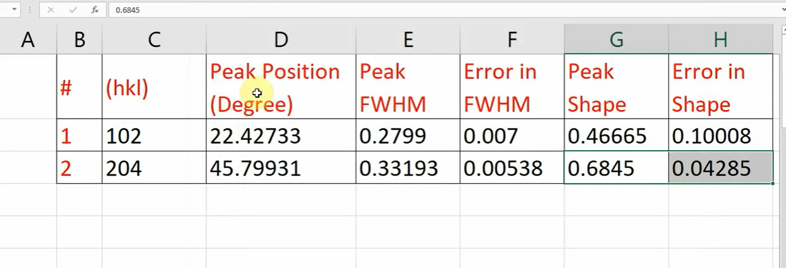

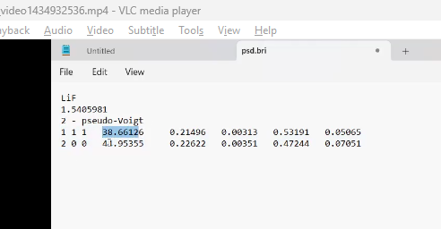

Change the values in psd.bri file  

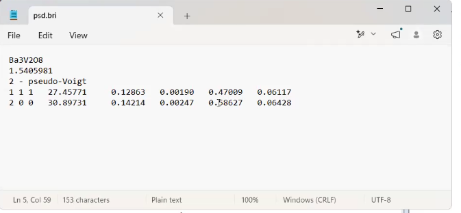

also change the hkl values

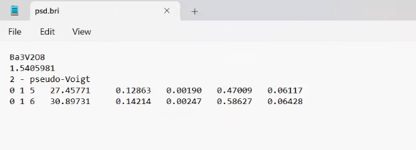

* Double click the Breadth.exe file

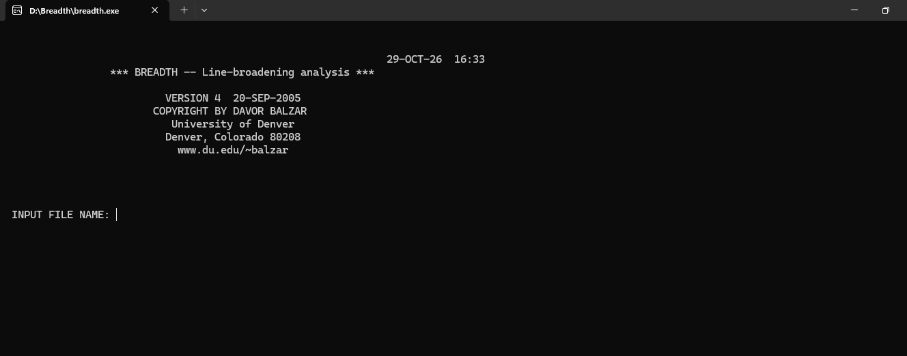

File content - 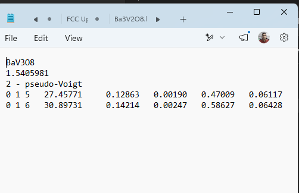

* Type down file name

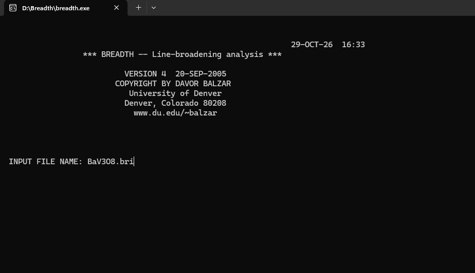

* After pressing enter you will get these files

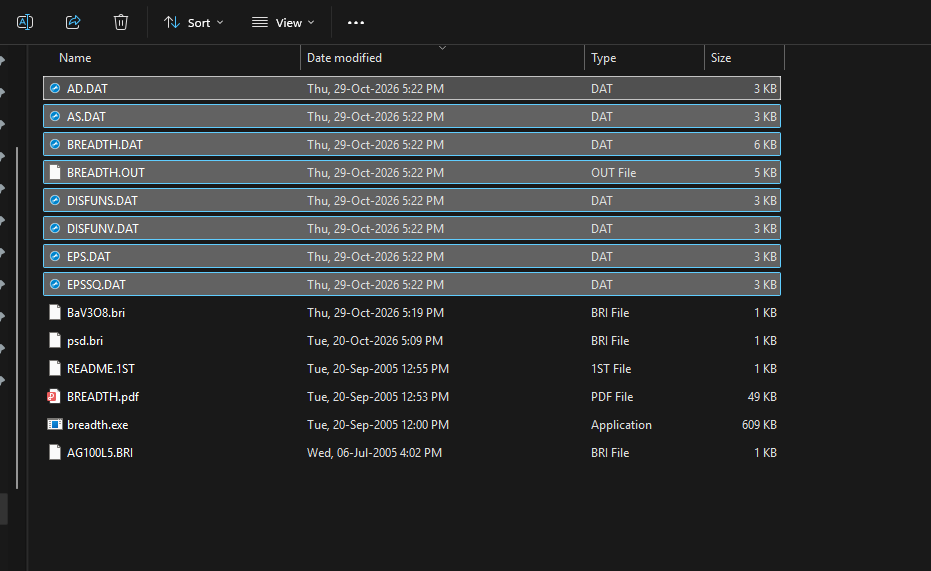

* You will get graph something similar to this

open the file DISFUNV.DAT file in origin and use scatter plot


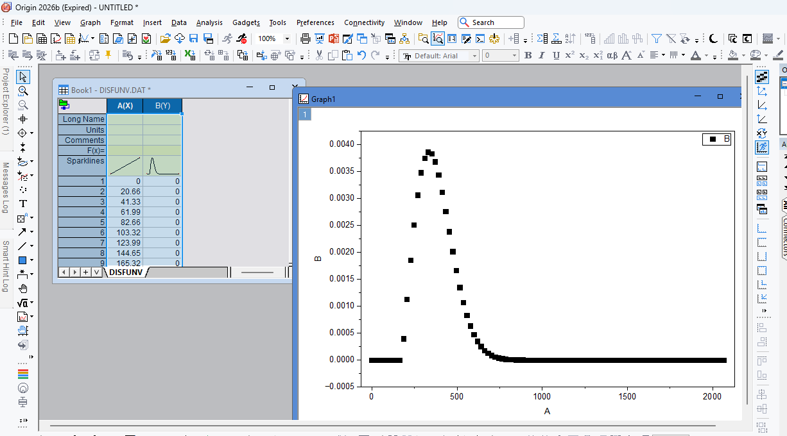

* Model size and mean size are roughly equal to each other
  * If it is perfect bell shape , then mean and model will be same

> how to obtain psd graph, hope it is clear.
> do similar for LiF